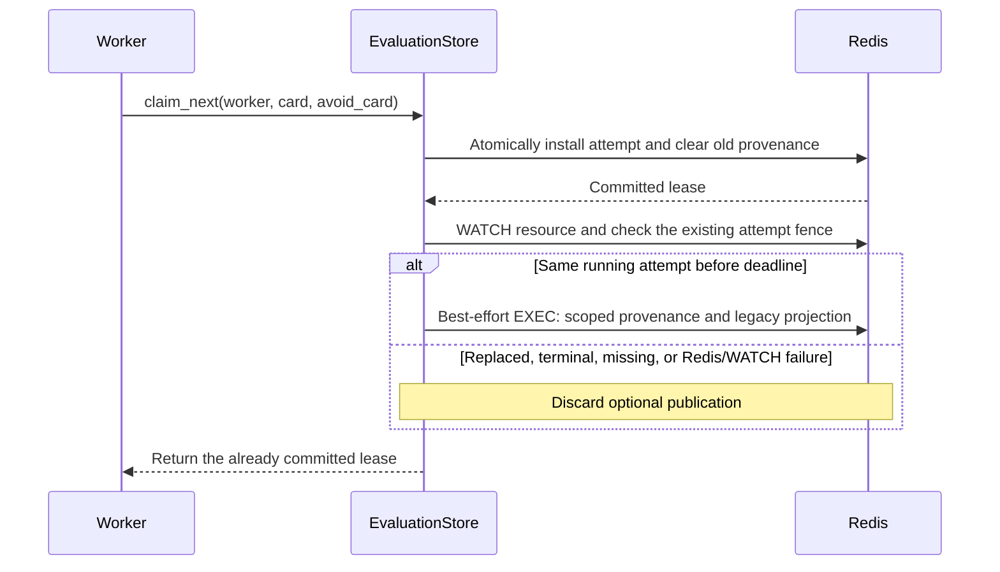

# Attempt card provenance

`EvaluationStore.claim_next(worker, card=..., avoid_card=...)` owns both attempt
installation and its optional card publication. `Worker` no longer coordinates
a second provenance write after claiming. The public `note_claimed_card` helper
has been removed; its evaluation ID alone could not identify the writing attempt.

`card` is the actual executing card. `avoid_card` is an independent scheduling
policy, so disabling affinity avoidance does not disable provenance or
card-attributed suspicious-death counting.

## Claim and publication

The attempt transaction writes an empty `attempt_card` field and removes the
previous `claimed_card`. Presence of `attempt_card` means this claim uses scoped
provenance, including when no card was supplied or publication failed.

After the claim commits, a separate optimistic transaction publishes:

- `attempt_card`: canonical JSON containing `attempt_id` and `card`.
- `claimed_card`: the same card as a legacy projection for older readers.

The publication reuses the existing running-state, attempt ID, fencing-token,
revision and resource-deadline checks. These fence conditions are unchanged;
card metadata is never a condition of lease renewal or terminal commit. A stale
attempt cannot publish after replacement, and WATCH prevents replacement between
the identity check and the write. Optional publication is not retried on a WATCH
conflict. Redis failure during publication does not discard the committed lease;
failure of the claim transaction itself still propagates.

## Recovery and existing data

The reaper accepts scoped provenance only when its attempt ID matches the
currently installed attempt and the card is a nonnegative integer. Empty,
malformed, or mismatched scoped data means unknown provenance, even when the
legacy field contains a value. A delayed pre-upgrade worker's unscoped HSET
therefore cannot override a new attempt's attribution in the updated reaper.

Running records that predate scoped provenance have no `attempt_card` field;
the updated reaper continues reading their legacy `claimed_card`. Each claim
made by the updated code establishes scoped provenance afresh. The legacy
projection supports old readers, but those readers retain their old attribution
behavior until upgraded. If an older worker replaces an attempt without clearing
a scoped record, its mismatched attempt ID is conservatively treated as unknown.

Unknown provenance does not add a card-attributed suspicious death. Existing
attempt limits and resource deadlines still bound retries. Poison counting and
terminal synthesis remain in the reaper, and the frozen public contract and
existing Redis keyspace are unchanged. The new field shares its resource's TTL.

## Verification

`tests/test_attempt_card.py` exercises the claim/recovery interface against
fakeredis. A Redis adapter inserts deterministic events after claim EXEC or
between the provenance check and its EXEC to model paused workers and WATCH
conflicts. Assertions use resource visibility, recovery outcomes, and affinity
decisions rather than calling private publication helpers.

Coverage includes delayed old claims, replacement without a card, Redis loss
before and after claim commitment, terminalization/retention before publication,
legacy records and writers, and unusable scoped data. `tests/test_worker.py`
also verifies card attribution when affinity avoidance is disabled. Existing
lease/fencing races and poison-quarantine tests remain part of the CPU suite.
