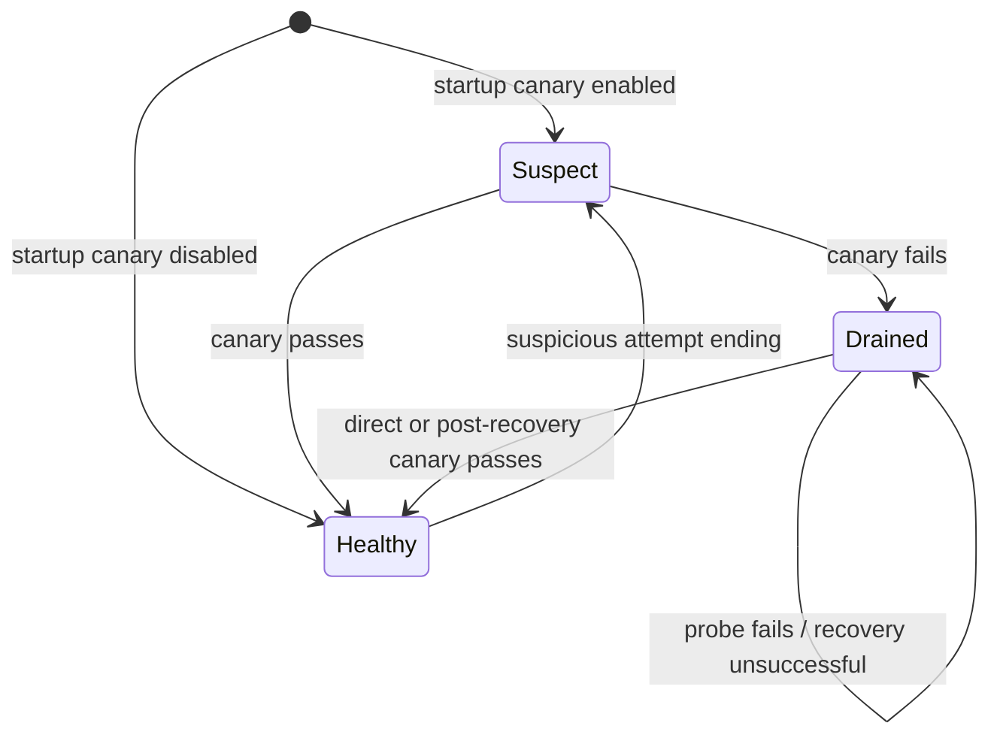

# Card health module

`CardHealth` owns canary gating, drain state, recovery timing, and health
publication. `Worker` owns evaluation attempts and consults the same health
decision before sending an idle heartbeat or claiming another attempt.
Domain terms are defined in [GLOSSARY.md](../../GLOSSARY.md).

## Interface and ownership

The external seam has two operations:

- `prepare_claim()` advances any due health work and returns whether this
  iteration may heartbeat and claim. Healthy workers do not rerun canaries.
- `mark_suspicious()` requires a new canary after a suspicious ending. It does
  not override an existing drained worker's cooldown.

Probe and recovery callables are injected hardware adapters; production uses
the existing NPU canary and recovery actions, while CPU tests provide scripted
outcomes. Redis storage and optional metrics are injected dependencies. The
module runs on the owning worker's main thread, as required by the canary's
signal-based budget.

All probe paths use one state transition and publication implementation. A
successful recovery clears the drained state regardless of which recovery
step succeeded. A recovery iteration does not claim; the next worker iteration
resumes heartbeats and claims without waiting for another canary interval.

## Invariants

- Heartbeats indicating available execution capacity follow the health gate.
  Existing heartbeats from a worker that becomes drained expire normally.
- Probe retries and recovery ladders have independent configured cooldowns.
  Production cooldowns use monotonic time; tests inject a clock. Each ladder
  step is followed by a canary, and successful recovery stops escalation.
- A failed probe drains locally even if its Redis publication fails. A
  successful probe grants eligibility only after the healthy marker is written.
  Redis errors propagate to the existing worker retry loop.
- Optional metrics cannot change recovery decisions. `card_health_state` is
  assigned `0` for healthy and `1` for unhealthy on each successful publication,
  so repeated probes or process restarts do not accumulate gauge deltas.
- Evaluation leases, terminal fencing, poison counting, and claim/card
  provenance remain owned by the existing durable evaluation logic.

## Optional engine-failure retries

`TRITON_EVAL_ENGINE_FAILURE_REQUEUE=true` enables retries within the same
evaluation when an engine returns a retryable execution failure and no requested
check produced data. The default is `false`: missing output does **not** prove
the failure happened before candidate execution. A candidate that crashes the
engine can also enter this path. This policy does not repair such a candidate
or turn an unknown crash into a candidate verdict.

The worker supports correctness and profile-only failures, including an
inconclusive compile precheck. Any produced check data, timeout, or
non-retryable error prevents a retry. The existing resource deadline and shared
three-attempt budget (including lease-loss recovery) still apply; terminal
fencing, identity, and quotas do not change. Disabling the flag affects future
retry decisions; already pending replacements remain claimable.

These failures require a new canary even with retry disabled or the attempt
budget exhausted. Unhealthy workers drain through the existing recovery ladder.
With affinity avoidance enabled, another card may claim immediately. The failed
card waits at most one lease window, capped at half the remaining resource
deadline, and may then retry only after passing the health gate. This allows
single-card instances to make progress. The bounded avoidance belongs only to
engine-failure replacements; the lease reaper retains its existing exclusion
and poison-counting policy.

`tests/test_engine_failure_requeue.py` covers opt-in behavior, evidence
preservation, single-card progress, cross-card preference, canary checks,
shared budgets, deadlines and stale attempts. Real NPU recovery behavior still
requires validation on an Ascend host before enabling this deployment option.

## Verification

`tests/test_card_health.py` exercises the module interface with fakeredis,
an injected clock, and scripted hardware actions: direct and ladder recovery,
cooldowns, probe/recovery exceptions, Redis publication failure, metric failure,
and gauge values across worker restarts. Low-level recovery action tests remain
at the hardware seam.

`tests/test_worker.py` verifies the integration: healthy startup, draining before
further claims, suspicious endings, and resumed work and heartbeats after ladder
recovery. The latter reproduces the previous defect: Redis could report a healthy
card while the worker retained its drained flag.

`tests/test_card_health_npu.py` remains the hardware check. CPU tests establish
the orchestration behavior; they do not establish real-device recovery behavior.
