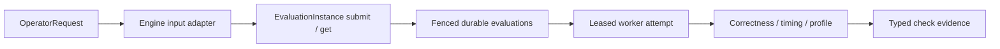

# Operator input and durable execution

The public `OperatorRequest` requires `cases` and at least one of `torch_code`
or `triton_code`. Each implementation exports `run(*args)`; cases describe
positional tensors and scalars with deterministic seeds. Both sources enable
comparison; one source enables measurement and profiling without correctness.
HTTP validation establishes the input shape.
It does not import or execute supplied code.

The operator adapter converts this input into the engine's existing reference
and candidate interfaces. It supplies the `Model` and input factories internally.
The resulting request enters `EvaluationInstance` and its ordinary durable
admission, lease, execution and recovery path. Internal v2.1 record models remain
available for persisted resources; they are not an alternative public input.

`/evaluations`, `/verify`, `/benchmark` and `/profile` use one capability registry
and one durable resource response. Shortcuts select the checks; the general
endpoint accepts an explicit selection. Caller identity owns visibility and
quotas. An optional session groups work, and an optional idempotency key makes
retry safe within its caller/session scope. Omitted keys submit fresh work.
Neither operation requires catalog lookup, a dataset adapter or a tool budget.

Worker execution support lives under `triton_evaluation/runtime/`, including
sandbox isolation, profiler integration, reference caches and diagnostics.
Evaluators own check orchestration; shared configuration and canonical
serialization remain at the package root. Moving these implementations requires
[new deployment source pins](../operations/recovery.md#runtime-module-migration).

Process entrypoints assemble dependencies explicitly. The API gives its instance
and durable store the same metrics adapter. The worker gives its store, lease
keeper and card-health module the same metrics adapter, and passes independent
`BaselineCache` and `VerdictCache` adapters to their consumers. Advisory caches
and metrics use a separate Redis client with bounded timeouts and no retries;
the durable store retains its own client and transition semantics.

`EvaluationEvaluator` receives already assembled correctness, benchmark and
profile adapters. It owns check ordering and evidence shaping, not runtime
configuration. All checks, including precheck, use the same subprocess runner
and a startup environment snapshot built from validated `Settings`. Each
invocation copies that snapshot and selects its own device. Precheck uses the
configured engine directory just like the device checks. Tests replace check
adapters through the constructor rather than overriding private factories.

Workers execute supplied code after admission. CPU workers own compile-only
checks; one NPU worker owns all requested device checks in an attempt. Evidence
publication is fenced so an older attempt cannot replace a newer result.
Missing evidence cannot establish success, and infrastructure failures remain
separate from candidate correctness outcomes.

Tests exercise public requests, source adaptation, Redis-backed admission and
resource recovery with CPU test doubles at the device boundary. Real NPU
correctness, timing and profiling require separate device validation. Existing
engine/reference-cache compatibility remains scoped to its pinned deployments;
the new input interface does not establish cache coverage for arbitrary operators.

Single-implementation timing has a distinct result with `implementation`,
`correctness_verified: false` and per-case latency, without reference speedup.
Single-implementation profiling carries the same non-verification marker. The
caller retains those semantics when interpreting a completed resource; success
of a measurement is not evidence of equality with another implementation.
