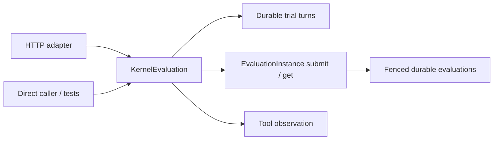

# Kernel evaluation caller intent

`KernelEvaluation.evaluate(action, body, session_id=..., operation_id=...)`
owns catalog-task resolution, request translation, durable trial turns,
operation identity, admission retry, waiting and optional diagnostics. It
returns a tool envelope or raises `ToolInputError` with an input rejection
kind. It imports no HTTP framework and never executes candidate code.

The HTTP adapter owns authentication, JSON decoding, selection of the session
from headers/body or the legacy remote-address fallback, and mapping rejection
kinds to HTTP status codes. It does not construct Redis dependencies, resolve
catalog entries or manage polling. The application composition root injects the
same owning instance and a budget registry using the same Redis namespace.
The registry's maximum is fixed at construction, like other deployment policy.

`ReleaseCatalog.resolve_task(task_id, manifest_id=...)` resolves an exact
`problem_id` and returns `CatalogTask(problem_id, reference_code, grade_context)`.
It requires one matching entry, validates the reference's containment in the
catalog root, regular-file status, UTF-8 encoding and SHA-256 binding, and
rechecks the bytes on lookup. Dataset prefixes, reference headers and provenance
sidecars are outside this serving interface. Offline adapters own source-format
conversion and provenance validation.

The translated evaluation's `op_name` is the catalog `problem_id`. The tool's
HTTP request and response shapes do not change. Existing official references
keep their original bytes and digests, while a previous sidecar operation name
may produce different canonical request bytes. Follow the
[upgrade procedure](../usage/kernel-eval.md#upgrade-from-official-only-task-lookup)
before switching an active instance. Engine compatibility and reference-cache
policies keep their existing scope.

The interface preserves two different identities:

- An explicit operation ID reserves one trial turn and derives a stable
  evaluation idempotency key. A conflicting request cannot consume another turn.
- Without an operation ID, each call reserves a new turn. Identical evaluation
  input still derives the same evaluation identity and may replay durable work.

Admission failures consume the reserved turn. Rate and inflight limits retry
the same idempotent admission with bounded backoff. Exhausting the wait budget
never cancels or terminalizes accepted work; the same operation can recover it.
Optional case-zero diagnostics reuse the primary wait deadline and do not
consume a second turn. Diagnostic failures preserve the primary observation.
Rendering still uses canonical contract bytes and the existing frozen fixtures.

The instance and Redis budget are existing modules, not new abstract repository
ports. The injected monotonic clock and asynchronous wait are a real seam for
deterministic deadline/quota tests. Policy tests cross the same `evaluate`
interface as callers using a real catalog, fakeredis, and fenced worker results;
HTTP tests cover transport behavior and end-to-end compatibility.

ADR 0001 and ADR 0002 remain in force. This refactor adds no shared cross-host
state, alternate execution path, result cache or scoring policy.
